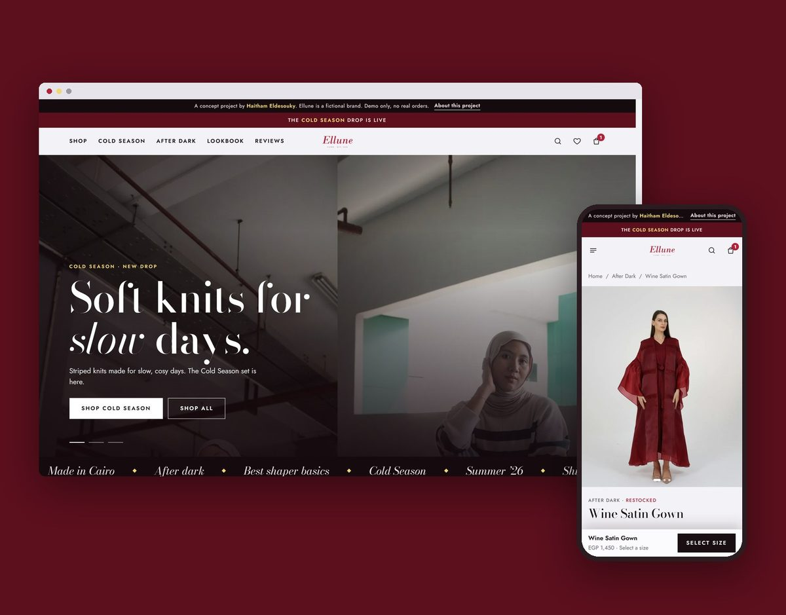

# Ellune Concept Store

A complete online store for **Ellune**, a fictional women's fashion label from Cairo. It's designed and built as a portfolio project by Haitham Eldesouky.

**Live demo:** https://haithameldesouky.github.io/ellune-store/

**Shopify:** the same design has also been built as a real Shopify store for a client (private, so it can't be shown here). This repo is the plain HTML/CSS/JS version. I can set up your store on Shopify with a design like this: Arabic/RTL, cash on delivery, local payments and shipping.



## What it does

- Collections, filters, sorting and search
- Product pages with colours, sizes, photo zoom and low-stock alerts
- Bag, wishlist and a free-delivery progress bar
- A checkout made for Egypt: all 27 governorates, delivery fees, mobile-number checks, cash on delivery and InstaPay
- Promo codes (`TIKTOK20`, `ELLUNE10`)
- Light and dark looks that follow the phone's setting
- Built for phones first

## How it's built

- One HTML file with plain CSS and JavaScript: no framework, no build step, no dependencies
- Hash routing with a link for every page, product and colour
- Bag and wishlist are kept in the browser (`localStorage`); no personal details are stored
- Keyboard-friendly dialogs, ARIA labels and reduced-motion support
- WebP images; the whole site is under 3 MB
- Tested at desktop and phone sizes, in light and dark mode, across every page and flow

## Run it locally

```bash
python -m http.server 8000
```

Then open http://localhost:8000.

## Notes

- Ellune is a fictional brand. Prices, stock and reviews are placeholders, and the checkout is a demo, so nothing is charged or sent.
- Photos are from [Unsplash](https://unsplash.com) and used under the [Unsplash License](https://unsplash.com/license). See [PHOTO-CREDITS.md](PHOTO-CREDITS.md).
